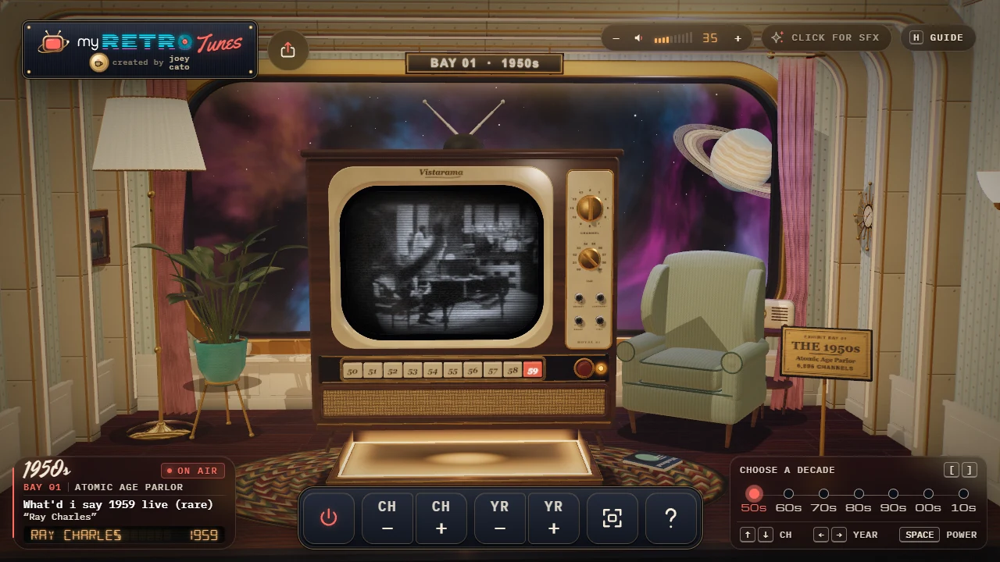
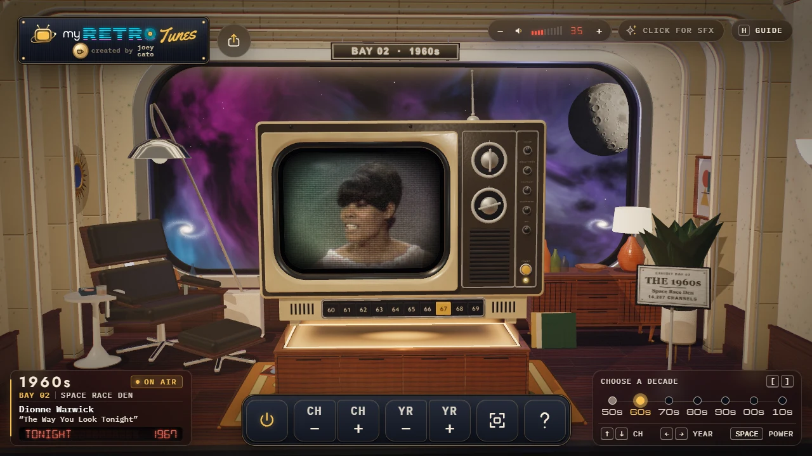
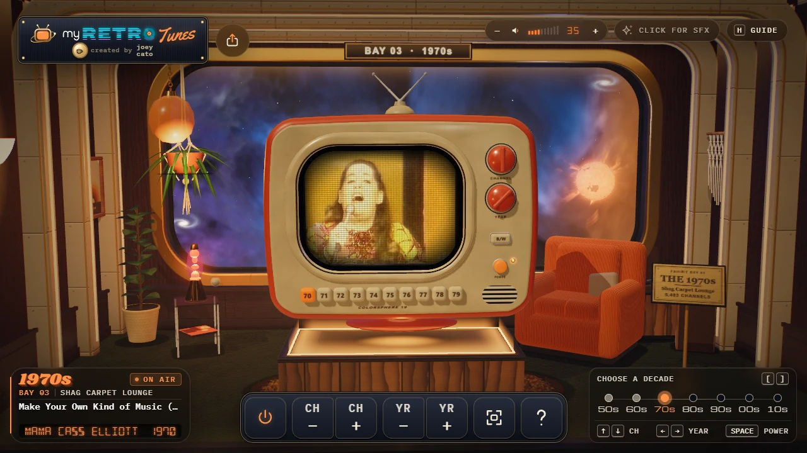
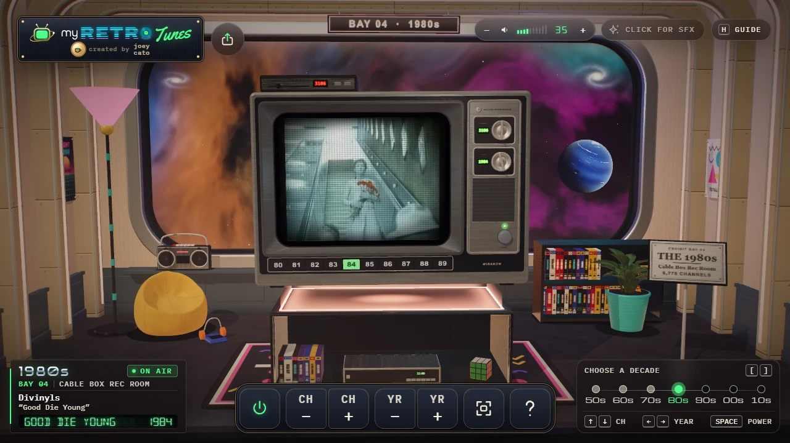
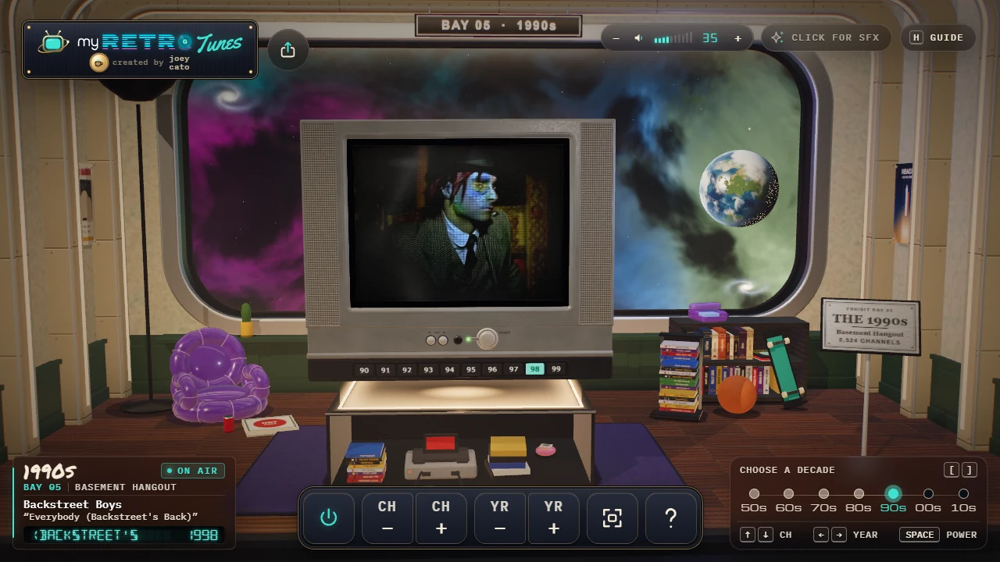
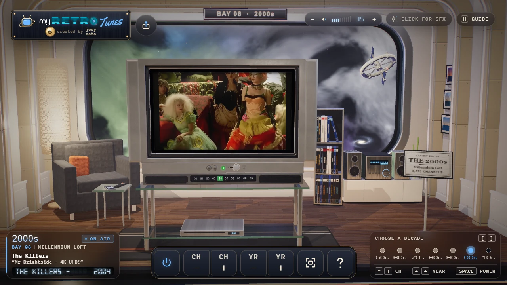
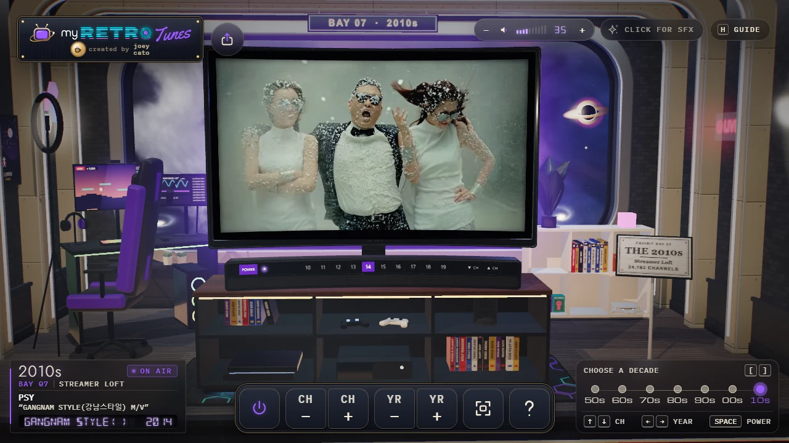

A new way to enjoy the old. Channel-surf music videos from 1950–2019 inside a starship gallery of nostalgic dioramas.

<a href="https://myretrotunes.com" target="_blank" rel="noopener noreferrer">
<video class="aligncenter" width="600" style="max-width: 100%; height: auto;" autoplay loop muted playsinline aria-label="Post rendering of MyRetroTVs site showing multiple TVs between 1950's and 2010's">
<source src="./video-cropped.mp4" type="video/mp4" />
</video>
</a>

Today I’m excited to launch MyRetroTunes, a follow-up website to my earlier project, MyRetroTVs.
This time I wanted it to feel more immersive. Instead of a TV on a web page, you’re aboard a starship gallery of Earth’s living rooms, one for each decade from the 1950s to the 2010s. Each room has a TV set from its era, playing that decade’s music videos.

What’s your favorite decade of music?

[Launch MyRetroTunes](https://myretrotunes.com/)
